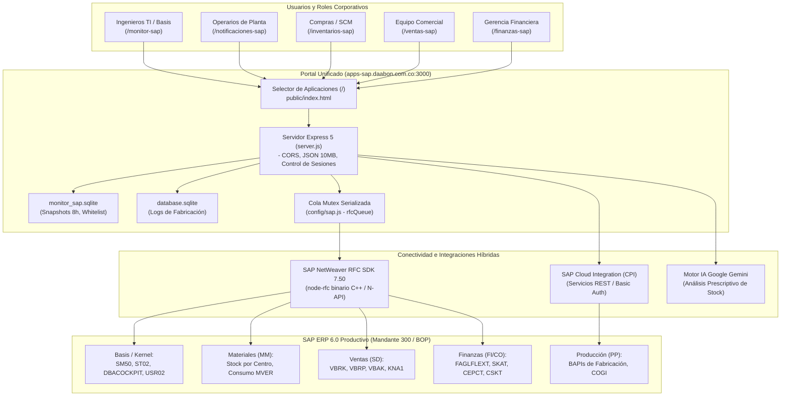

# Plataforma Unificada de Aplicaciones SAP
### Conectividad en Tiempo Real con SAP NetWeaver (RFC Binario), SAP Cloud Integration (CPI) e Inteligencia Artificial

---

## 1. Resumen Ejecutivo de la Plataforma

La **Plataforma Unificada de Aplicaciones SAP** (`https://apps-sap.daabon.com.co/`) es un ecosistema web empresarial desarrollado para centralizar, simplificar y modernizar el acceso a la información y operaciones del sistema **SAP ECC 6.0 (Mandante 300 - Grupo Daabon)**.

La plataforma coexiste de forma segura y eficiente en un único servidor Node.js/Express (puerto `3000`, servidor Linux `10.0.0.146`), ofreciendo un portal unificado en `/` y **cinco módulos especializados** diseñados para diferentes áreas estratégicas y operativas de la organización.

---

## 2. Mapa de Módulos y Documentación Específica

Cada módulo cuenta con su propio **`README` técnico y funcional detallado**, con diagramas de flujo, esquemas de tablas, endpoints y glosario específico:

| Módulo | Ruta Web | Audiencia / Rol | Integración SAP | Documentación Dedicada |
| :--- | :--- | :--- | :--- | :--- |
| **1. Monitor SAP ERP** | `/monitor-sap` | Equipo Basis, TI e Infraestructura | SAP NetWeaver RFC SDK (`node-rfc` binario C++) + Motor Oracle (`DBACOCKPIT`) | 📘 [README_MONITOR.md](README_MONITOR.md) |
| **2. Notificaciones SAP** | `/notificaciones-sap` | Supervisores y Operarios de Planta | SAP Cloud Integration (CPI) vía HTTP REST + Microsoft Entra ID SSO | 📘 [README_NOTIFICACIONES.md](README_NOTIFICACIONES.md) |
| **3. Optimizador Inventarios IA** | `/inventarios-sap` | Compras, Cadena de Suministro y Demand Planning | SAP RFC (`ZFMM_STOCK_BY_WERKS`, `ZFMM_HISTORICO_CONSUMO` / `MVER`) + Google Gemini IA | 📘 [README_INVENTARIOS.md](README_INVENTARIOS.md) |
| **4. Ventas y Predicción SAC** | `/ventas-sap` | Dirección Comercial y Ventas Internacionales | SAP SD RFC (`VBRK`, `VBRP`, `VBAK`, `KNA1`) + Smart Predict Machine Learning | 📘 [README_VENTAS.md](README_VENTAS.md) |
| **5. Desempeño Financiero SAC** | `/finanzas-sap` | Dirección General, Finanzas y Control de Gestión | SAP FI/CO RFC (`FAGLFLEXT`, `SKAT`, `CEPCT`, `CSKT`) + Value Driver Tree & Monte Carlo | 📘 [README_FINANZAS.md](README_FINANZAS.md) |

---

## 3. Diagrama de Arquitectura Global de la Plataforma



---

## 4. Guía de Instalación y Despliegue en Servidor

### Requisitos Previos
* **Node.js**: Versión 18 LTS o 20 LTS.
* **SAP NetWeaver RFC SDK 7.50**:
  * **En Linux (`10.0.0.146`)**: `/home/plant/nwrfcsdk/lib` configurado en `LD_LIBRARY_PATH`.
  * **En Windows**: `C:\nwrfcsdk\lib` configurado en `PATH`.
* **Herramientas de Compilación**: `make`, `g++` (Linux) o Visual Studio C++ Build Tools (Windows) para el addon binario `node-rfc`.

### Pasos de Instalación
```bash
# 1. Clonar el repositorio
git clone https://github.com/danianre/DashboardSAP.git
cd DashboardSAP

# 2. Instalar dependencias
npm install

# 3. Validar sintaxis e integridad pre-despliegue
node scripts/validate-build.js

# 4. Iniciar en desarrollo local
npm start
```

### Variables de Entorno (`.env`)
```ini
# Configuración del servidor
PORT=3000
ENVIRONMENT_NAME=PRODUCTIVO

# Conexión SAP NetWeaver RFC
SAP_LIVE=true
SAP_ASHOST=10.0.0.100
SAP_SYSNR=00
SAP_CLIENT=300
SAP_USER=USUARIO_SERVICIO
SAP_PASSWORD=PasswordSeguroSAP
SAP_ROUTER=/H/sap.daabon.com.co

# Conexión SAP Cloud Integration (CPI)
CPI_URL_CONSULTA=https://[tenant]-cpi.hana.ondemand.com/http/sap/consulta_orden
CPI_URL_NOTIF=https://[tenant]-cpi.hana.ondemand.com/http/sap/registro_notificacion
CPI_USER=CPI_USER
CPI_PASS=PasswordCPI
```

---

## 5. Control de Calidad y Pipeline CI/CD

El repositorio incluye un **gatekeeper estricto** en `scripts/validate-build.js`:
* Comprueba la sintaxis de todos los archivos de servidor y servicios (`node --check`).
* Verifica que las 6 vistas HTML (`index.html`, `monitor.html`, `notificaciones.html`, `inventarios.html`, `ventas.html`, `finanzas.html`) contengan todos los componentes y rutas requeridas.
* Escanea el código fuente para garantizar que no existan credenciales ni claves privadas expuestas.
* Se ejecuta automáticamente antes de cada commit y en GitHub Actions (`.github/workflows/deploy.yml`).

---

## 6. Documentación Detallada por Módulo

Para profundizar en la arquitectura técnica, estructuras de datos y funcionamiento de cada herramienta, consulta los manuales dedicados:
1. 🖥️ **[Consola de Monitoreo SAP ERP (Basis)](README_MONITOR.md)**
2. 🏭 **[Notificaciones de Fabricación (Planta)](README_NOTIFICACIONES.md)**
3. 📦 **[Optimizador de Inventarios con IA (Compras/SCM)](README_INVENTARIOS.md)**
4. 📈 **[Análisis de Ventas y Predicción SAC (Comercial)](README_VENTAS.md)**
5. 💰 **[Desempeño Financiero y Simulación SAC (Finanzas)](README_FINANZAS.md)**
