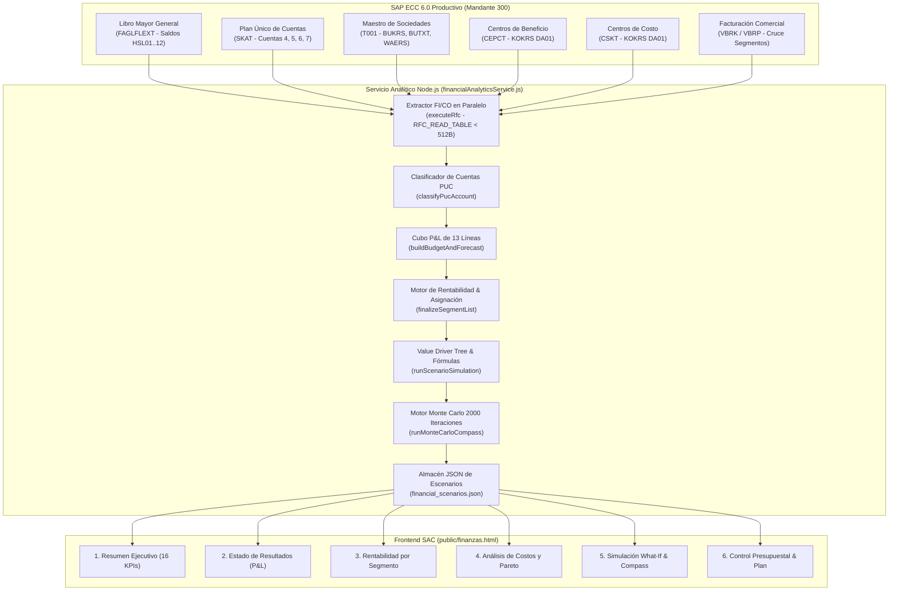

# Módulo de Desempeño Financiero y Simulación de Escenarios — SAP Analytics Cloud (SAC)
### Estado de Resultados (P&L), Rentabilidad Multidimensional, Value Driver Tree & Simulación Monte Carlo Compass

---

## 1. Resumen Ejecutivo del Módulo

El **Módulo de Desempeño Financiero y Simulación de Escenarios** (`/finanzas-sap`) es la herramienta gerencial de inteligencia financiera diseñada para la Dirección General, la Gerencia Financiera y el equipo de Control de Gestión, integrando las metodologías de planificación financiera de **SAP Analytics Cloud (SAC Planning, Value Driver Tree & Compass)**.

### El Reto en el Control Financiero Tradicional
En corporaciones multilatinas con múltiples sociedades, plantas y centros de costos:
* Los estados financieros tradicionales se emiten semanas después del cierre contable mensual y suelen ser estáticos en formato PDF o Excel.
* No existe claridad inmediata sobre qué líneas de producto, clientes o unidades de negocio son verdaderamente rentables una vez asignados los costos directos e indirectos de operación.
* Evaluar el impacto económico de decisiones estratégicas (como variar precios, afrontar incrementos en materias primas o cambios en la tasa de cambio USD/COP) requiere semanas de recálculo manual propenso a desajustes de fórmulas.

### La Solución Implementada
El sistema extrae y procesa en vivo más de **125,000 registros contables** del Libro Mayor General de **SAP ECC 6.0 (Mandante 300 / Área de Controlling `DA01`)**:
1. **Estado de Resultados (P&L) Oficial de 13 Niveles**: Estructura contable jerárquica con evaluación semafórica inteligente de desviaciones entre la Ejecución Real (`Actual`), el Presupuesto Aprobado (`Budget`), el Pronóstico Rolling (`Forecast`) y el Ejercicio Anterior (`YoY`).
2. **Rentabilidad por Segmento con Gobernanza de Costos**: Visualización transparente de márgenes por Producto, Cliente, Región, Sociedad y Centro de Beneficio, permitiendo alternar entre **Contribución Directa** (sin prorrateo) y **Rentabilidad Completa** (con distribución proporcional de gastos indirectos).
3. **Análisis de Costos, Pareto y Ratios de Eficiencia**: Desglose de costos de producción por naturaleza, proporción de costos fijos vs. variables, curva de Pareto 80/20 y cálculo del punto de equilibrio operativo.
4. **Simulador What-If, Árbol de Creación de Valor (VDT) y Monte Carlo (Compass)**:
   * **12 Palancas Estratégicas**: Precios, volumen, descuentos, mezcla, materias primas, producción, logística, administración, comercial, nómina, TRM y tasas de interés.
   * **Value Driver Tree (VDT)**: Árbol interactivo que propaga matemáticamente el impacto de cada palanca sobre el EBIT, EBITDA y la Utilidad Neta.
   * **Simulación Probabilística Monte Carlo (2,000 iteraciones)**: Histograma de distribución, percentiles P10 (Pesimista), P50 (Mediana) y P90 (Optimista), probabilidad de cumplir la meta y diagrama tornado de sensibilidad.
5. **Persistencia de Escenarios y Recomendaciones Prescriptivas**: Capacidad de guardar escenarios personalizados por usuario y motor de recomendaciones estratégicas cuantificadas en Miles de Millones COP.

---

## 2. Arquitectura de Datos y Conectividad con SAP FI/CO

---

## 3. Las 6 Páginas de la Historia Financiera SAC

### Página 1: Resumen Financiero Ejecutivo
* **16 Tarjetas KPI Oficiales**:
  * **Ingresos (5)**: Ingresos Totales Brutos, Ingresos Netos Reconocidos, Variación Interanual de Ingresos (%), Ingresos Acumulados del Año (YTD) y Cumplimiento Presupuestal de Ingresos (%).
  * **Costos y Estructura de Gastos (5)**: Costos y Gastos Operacionales Totales, Costo de Ventas Directo, Gastos Operacionales Totales, Gastos Administrativos y Gastos Comerciales/Distribución.
  * **Rentabilidad y Generación de Caja (6)**: Utilidad Bruta, Margen Bruto (%), Utilidad Operacional (EBIT), Margen Operacional (%), EBITDA Operativo y Utilidad Neta del Ejercicio con Margen Neto (%).
* **Gráficos Ejecutivos**: Evolución mensual comparativa (Real vs. Presupuesto vs. Pronóstico) y Puente de Resultados (*Waterfall Chart*) desde Ingresos Brutos hasta Utilidad Neta.

### Página 2: Estado de Resultados Consolidado (P&L Interactivo)
Estructura jerárquica de 13 niveles con semáforo inteligente de variaciones:
1. Ingresos operacionales brutos
2. (-) Descuentos y devoluciones en ventas
3. (=) **Ingresos operacionales netos**
4. (-) Costo de ventas y operación directa
5. (=) **Utilidad bruta**
6. (-) Gastos comerciales y de distribución
7. (-) Gastos administrativos
8. (-) Otros gastos operacionales (Depreciaciones y amortizaciones)
9. (=) **Utilidad operacional (EBIT)**
10. (+/-) Ingresos y gastos no operacionales netos
11. (-) Gastos financieros y comisiones bancarias
12. (-) Impuesto de renta y complementarios
13. (=) **Resultado neto del ejercicio**

### Página 3: Rentabilidad por Segmento y Reglas de Asignación
* **Conmutador de Imputación de Costos**:
  * **Contribución Directa**: Evalúa los segmentos únicamente frente a su costo de ventas directo registrado.
  * **Rentabilidad Completa**: Asigna proporcionalmente los gastos comerciales, administrativos, financieros e impuestos sobre la base de ingresos netos y volumen.
* **Matriz de Cuadrantes Estratégicos de Productos**:
  * *Estrellas*: Alta Venta / Alto Margen.
  * *Generadores de Volumen*: Alta Venta / Bajo Margen.
  * *Especialidades Rentables*: Baja Venta / Alto Margen.
  * *Candidatos a Optimización*: Baja Venta / Bajo Margen.
* **Desgloses Multidimensionales**: Por Producto, Cliente Corporativo, Mercado/Región, Sociedad Mercantil y Centro de Beneficio.

### Página 4: Análisis de Costos, Gastos y Eficiencia Operativa
* **4 Indicadores Clave de Eficiencia**:
  1. Relación Costo de Ventas / Ingresos Netos.
  2. Relación Gastos Operacionales / Ingresos Netos.
  3. Costo Unitario Promedio Operativo por unidad física.
  4. Contribución Marginal Total y Punto de Equilibrio Operativo.
* **Composición de Costos**: Desglose de materias primas, mano de obra directa, costos indirectos de planta (CIF) y servicios.
* **Curva de Pareto (80/20)**: Identificación de las cuentas contables críticas (Clasificación A, B y C).
* **Ranking de Centros de Costos**: Centros con mayor absorción presupuestal y proporción de costos fijos vs. variables.

### Página 5: Simulación de Escenarios, Value Driver Tree y Monte Carlo (Compass)
* **12 Sliders Interactivos**:
  * *Ingresos*: Precio promedio (+/-), Volumen físico (+/-), Tasa de descuento (+/-), Mezcla de productos (+/-).
  * *Costos*: Materias primas (+/-), Costos de planta (+/-), Fletes y logística (+/-).
  * *Gastos*: Gastos administrativos (+/-), Gastos comerciales (+/-), Nómina y personal (+/-).
  * *Macroeconómicas*: Tasa de cambio USD/COP (+/-), Variación de tasas de interés de deuda (pbs).
* **Value Driver Tree (VDT)**: Nodos interconectados por fórmulas matemáticas reales que actualizan el árbol de valor en tiempo real.
* **Gestión de Escenarios**: Escenarios base (*Optimista*, *Base*, *Pesimista*) y creación de escenarios personalizados guardados en disco.
* **Simulación Probabilística Monte Carlo (SAC Compass)**: 2,000 iteraciones estocásticas con distribución Box-Muller determinística, histograma de probabilidades, percentiles P10/P50/P90, probabilidad de cumplir la meta y diagrama tornado de sensibilidad.

### Página 6: Control Presupuestal y Recomendaciones Estratégicas
* **Control de Desviaciones por Sociedad**: Seguimiento de ejecución de ingresos y control de sobreejecución de costos.
* **Plan de Acción Prescriptivo**: 4 recomendaciones estratégicas con hallazgo contable, métricas de soporte, impacto potencial cuantificado en Miles de Millones COP y supuestos aplicados.

---

## 4. Endpoints del Backend (`server.js`)

| Método | Endpoint | Descripción |
| :--- | :--- | :--- |
| `GET` / `POST` | `/api/finanzas/overview` | Consulta y cálculo consolidado del P&L, KPIs, rentabilidad, costos, presupuesto y escenarios según los filtros activos. |
| `POST` | `/api/finanzas/simulate` | Ejecuta la simulación What-If, el recálculo del Value Driver Tree y la simulación Monte Carlo para los 12 sliders activos. |
| `GET` | `/api/finanzas/scenarios` | Retorna la lista completa de escenarios predefinidos y personalizados guardados. |
| `POST` | `/api/finanzas/scenarios` | Guarda un nuevo escenario personalizado con autor, fecha, supuestos y versión base. |
| `DELETE` | `/api/finanzas/scenarios/:id` | Elimina un escenario personalizado creado por el usuario. |

---

## 5. Glosario Financiero y de Controlling (SAP FI/CO)

* **P&L (Profit and Loss)**: Estado de Resultados integral que refleja los ingresos, costos, gastos e impuestos de un ejercicio fiscal.
* **EBIT (Earnings Before Interest and Taxes)**: Utilidad Operacional generada exclusivamente por las operaciones del negocio.
* **EBITDA**: Utilidad antes de intereses, impuestos, depreciaciones y amortizaciones; métrica estándar de generación de flujo de caja operativo.
* **Centro de Beneficio (PRCTR)**: Unidad organizativa en Controlling que refleja la responsabilidad sobre resultados y rentabilidad.
* **Centro de Costo (KOSTL)**: Unidad organizativa donde se originan y acumulan los costos y gastos indirectos.
* **Value Driver Tree (VDT)**: Representación visual y matemática de cómo los inductores operativos impactan los resultados financieros finales.
* **Monte Carlo / SAC Compass**: Técnica estocástica de simulación probabilística que evalúa miles de combinaciones de riesgo e incertidumbre.
