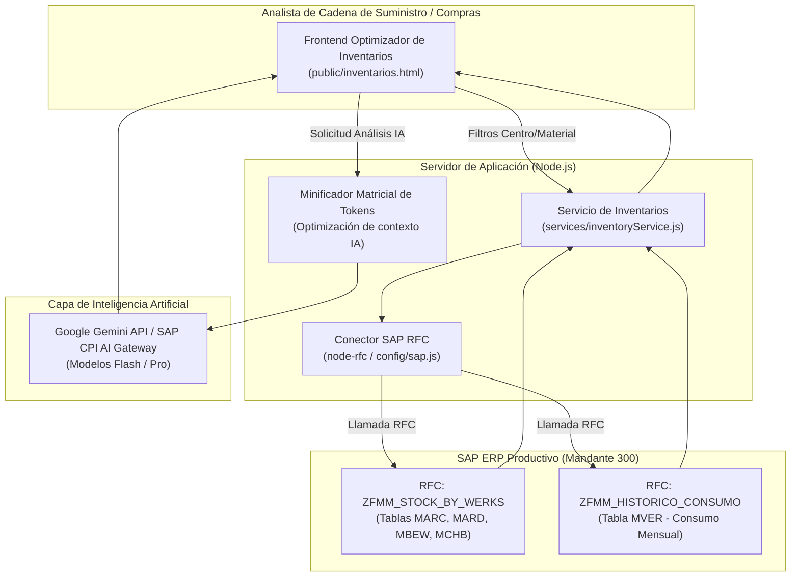

# Módulo de Analítica Inteligente de Inventarios & Optimizador IA
### Auditoría de Capital Inmovilizado y Proyección Estacional de Demanda con SAP RFC e Inteligencia Artificial

---

## 1. Resumen Ejecutivo del Módulo

El **Módulo de Analítica Inteligente de Inventarios** (`/inventarios-sap`) es la herramienta especializada desarrollada para los equipos de Compras, Cadena de Suministro (Supply Chain) y Planeación de Demanda (Demand Planning).

### El Reto en la Gestión de Inventarios SAP
En empresas agroindustriales y de manufactura con múltiples plantas y centros de distribución:
* La información de existencias físicas (`MMBE`, `MD04`, `MC.9`) está dispersa entre centros (`WERKS`) y almacenes (`LGORT`), impidiendo una visión consolidada del capital atrapado en bodega.
* Los consumos históricos registrados en la tabla estándar `MVER` de SAP rara vez se analizan con modelos estadísticos avanzados o estacionales, derivando en compras duplicadas o pedidos de reposición tardíos.
* El cálculo de stocks de seguridad y puntos de reorden depende de estimaciones empíricas que no se ajustan a las variaciones reales de la demanda.

### La Solución Desarrollada
El módulo integra consultas RFC binarias de alto rendimiento directamente con SAP ECC 6.0 junto a un motor de **Inteligencia Artificial generativa y prescriptiva**:
1. **Auditoría de Excesos de Stock (`EXCESO_INV`)**:
   * Identifica en 1 clic los materiales con coberturas superiores a los días de inventario objetivo (DOH).
   * Cuantifica el capital inmovilizado en Pesos Colombianos (COP) según la valoración contable estándar de cada material.
   * Clasifica los materiales según su criticidad operativa (obsolescencia, baja rotación, sobrestock preventivo).
2. **Proyección Estacional de Demanda (`PROYECCION_INV`)**:
   * Extrae la matriz completa de consumos históricos mensuales de los últimos 24 meses desde la tabla SAP `MVER`.
   * Calcula medias móviles ponderadas, tendencias de crecimiento interanual e índices de estacionalidad por centro.
   * Proyecta el consumo esperado para los siguientes períodos y alerta sobre riesgos de quiebre de stock mínimo.
3. **Diagnóstico y Recomendaciones con Inteligencia Artificial**:
   * Un motor de IA (Google Gemini / CPI) analiza la matriz de existencias o la serie temporal y redacta un informe ejecutivo con recomendaciones inmediatas de rebalanceo entre centros, liquidación de lotes o ajustes en el plan maestro de producción (MPS).

---

## 2. Arquitectura de Integración (SAP RFC + Motor IA)

---

## 3. Endpoints y Procesos del Backend (`services/inventoryService.js`)

| Endpoint | Proceso Funcional | Entrada (JSON) | Salida (JSON) |
| :--- | :--- | :--- | :--- |
| `POST /api/inventarios/stock` | `EXCESO_INV` | `{ "matnrLow": "...", "matnrHigh": "...", "werks": "1001", "werksHigh": "" }` | Lista de existencias con stock libre (`LABST`), stock en inspección (`INSME`), stock de seguridad (`EISBE`), valor total (`SALK3`) y cálculo de días de inventario. |
| `POST /api/inventarios/consumo` | `PROYECCION_INV` | `{ "matnrLow": "...", "matnrHigh": "...", "werks": "1001", "werksHigh": "" }` | Matriz mensual de consumo de 24 meses (`GSV01`..`GSV12`) con promedios, desviaciones estándar y proyección calculada. |
| `POST /api/inventarios/ai-analyze` | Análisis IA | `{ "processType": "EXCESO_INV", "rows": [...], "filters": {...}, "preferredModel": "gemini-1.5-flash" }` | Diagnóstico ejecutivo, riesgos operacionales identificados, materiales críticos y plan de acción de 4 puntos redactado por la IA. |

---

## 4. Algoritmos de Optimización y Cobertura de Inventario

### 4.1. Días de Inventario Disponible (Days of Inventory on Hand - DOH)
$$\text{DOH} = \frac{\text{Stock Disponible (Unidades)}}{\text{Consumo Promedio Diario (Unidades)}} = \frac{\text{LABST}}{\text{Consumo Mensual Promedio} / 30}$$

* **$\text{DOH} > 120$ días**: Alerta de **Sobre-Stock Crítico / Capital Inmovilizado**.
* **$30 \le \text{DOH} \le 90$ días**: Rango de operación saludable para insumos industriales.
* **$\text{DOH} < 15$ días**: Alerta de **Riesgo Inminente de Quiebre de Stock**.

### 4.2. Minificación Matricial para Modelos de Lenguaje
Para enviar cientos de filas de materiales al modelo de IA sin exceder los límites de tokens ni elevar los costos computacionales, el módulo convierte las estructuras de objetos JSON en matrices tabulares compactas sin llaves repetitivas (`[MATNR, WERKS, STOCK, VALOR, DOH]`), logrando una compresión del 70% del tamaño del prompt antes del envío al API de Gemini.

---

## 5. Glosario de Inventarios y Gestión de Materiales (SAP MM)

* **WERKS**: Código de 4 caracteres que identifica el Centro o Planta en SAP (ej. `1001`, `2600`, `4501`).
* **LGORT**: Almacén físico dentro de un centro (ej. `0001` Materias Primas, `0002` Producto Terminado).
* **LABST**: Cantidad en stock de libre utilización (disponible inmediatamente para ventas o consumo).
* **INSME**: Stock en inspección de control de calidad (no disponible para entrega sin liberación previa).
* **SPEME**: Stock bloqueado por deterioro, cuarentena o inconformidad.
* **MVER**: Tabla histórica de consumos periódicos de materiales en SAP.
* **SALK3**: Valoración contable total del stock en la moneda local de la sociedad.
