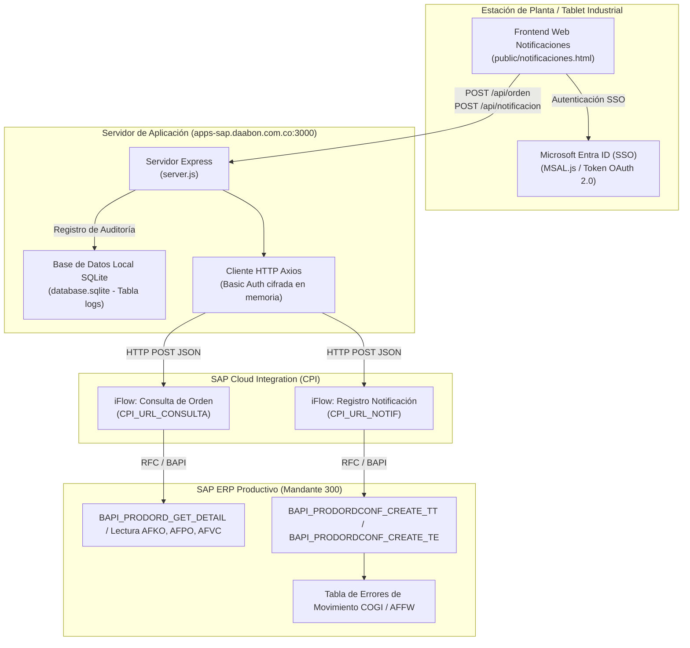

# Módulo de Notificaciones SAP Producción & Integración CPI
### Contabilización de Órdenes de Fabricación en Tiempo Real con Microsoft Entra ID SSO & SAP Cloud Integration

---

## 1. Resumen Ejecutivo del Módulo

El **Módulo de Notificaciones SAP Producción** (`/notificaciones-sap`) es la solución web empresarial diseñada para digitalizar, agilizar y auditar el registro operativo de planta en el sistema SAP ERP (Módulo PP - Production Planning).

### El Reto Operativo Tradicional en Planta
Históricamente, los supervisores y operarios de planta debían registrar los avances de producción en terminales fijas mediante transacciones complejas de SAP GUI (`CO11N`, `COR6N`, `CO15`, `COGI`), o registrar partes manuales en papel para transcripción diferida por personal administrativo. Esto generaba:
* Retrasos de horas o días en la actualización del inventario en proceso y producto terminado.
* Errores de digitación en tiempos de ciclo, cantidades producidas y paradas operativas.
* Movimientos fallidos de mercancías retenidos silenciosamente en la transacción `COGI` (inconsistencias de lote, falta de stock de componentes o almacén cerrado).
* Riesgos de seguridad por cuentas genéricas compartidas en terminales de planta.

### La Solución Implementada
La aplicación proporciona una interfaz web táctil, optimizada para tablets y estaciones industriales, que se conecta directamente con **SAP Cloud Integration (CPI)**:
1. **Inicio de Sesión Único Corporativo (SSO)**: Autenticación mediante Microsoft Entra ID (Azure AD) con `MSAL.js`, garantizando la identidad inequívoca de cada operario o supervisor.
2. **Consulta Rápida de Órdenes**: Validación instantánea del número de orden de fabricación (`AUFNR`), recuperando en milisegundos las operaciones pendientes, materiales, lotes y centros de trabajo.
3. **Notificación Integral de Tiempos y Cantidades**: Registro ágil de cantidad buena producida, reproceso, rechazo, tiempos de máquina, tiempos de mano de obra y paradas por avería con sus códigos de causa.
4. **Detección Automática de Retenciones COGI**: Al recibir la confirmación de SAP (`EV_RUECK`), el sistema analiza inmediatamente la tabla de retorno `ET_COGI` para alertar al operario si hubo errores de determinación de lote o falta de stock de insumos.
5. **Auditoría Local Ultrarrápida (`database.sqlite`)**: Cada intento de notificación, su carga JSON completa, usuario Microsoft autenticado, tiempo de respuesta y confirmación de SAP quedan almacenados en la base de datos local SQLite para fines de trazabilidad y soporte inmediato.

---

## 2. Arquitectura de Conectividad con SAP Cloud Integration (CPI)

El módulo opera como un cliente HTTP/REST seguro hacia los flujos de integración (*iFlows*) desplegados en **SAP Cloud Integration (CPI)**, los cuales a su vez invocan las BAPIs correspondientes de Control de Producción en el SAP ERP central.



---

## 3. Endpoints del Backend (`server.js`)

| Método | Endpoint | Parámetros / Payload | Descripción Técnica |
| :--- | :--- | :--- | :--- |
| `POST` | `/api/orden` | `{ "orden": "10023456" }` | Reenvía la consulta al iFlow de consulta en SAP CPI para extraer datos de la orden, operaciones, texto y materiales. |
| `POST` | `/api/notificacion` | `{ "payload": { "IV_AUFNR": "...", "IV_VORNR": "...", ... }, "usuario": "operario@daabon.com.co" }` | Envía la notificación de tiempos/cantidades a SAP CPI. Registra el evento en `database.sqlite` e inspecciona `ET_COGI`. |
| `GET` | `/api/logs` | `?orden=...&usuario=...` | Retorna los últimos 50 eventos de notificación registrados localmente para auditoría y resolución de dudas en planta. |

### Esquema de la Tabla de Auditoría (`database.sqlite`)

```sql
CREATE TABLE IF NOT EXISTS logs (
  id INTEGER PRIMARY KEY AUTOINCREMENT,
  fecha TEXT,        -- Fecha y hora en huso horario Colombia (UTC-5)
  usuario TEXT,      -- Correo corporativo Microsoft del operario
  orden TEXT,        -- Número de Orden de Fabricación SAP (AUFNR)
  operacion TEXT,    -- Número de Operación en la hoja de ruta (VORNR)
  estado TEXT,       -- 'ÉXITO' | 'ADVERTENCIA (COGI)' | 'ERROR EN SAP' | 'ERROR HTTP xxx'
  rueck TEXT,        -- Número de confirmación retornado por SAP (EV_RUECK)
  payload TEXT,      -- JSON exacto enviado hacia SAP CPI
  respuesta TEXT     -- Respuesta JSON completa devuelta por SAP CPI
);
```

---

## 4. Estructura de Datos e Inconsistencias `COGI`

Cuando SAP confirma una notificación de fabricación:
1. Si la contabilización física y de materiales es perfecta, devuelve el campo `EV_RUECK` con el consecutivo de confirmación y el estado `ÉXITO`.
2. Si la confirmación de tiempos se realiza pero falla el consumo automático de materias primas (toma retroactiva / *backflushing*), SAP genera registros en la tabla `ET_COGI`:
   * **Causa 1**: Stock insuficiente del lote en el almacén de consumo.
   * **Causa 2**: Lote caducado, bloqueado o no asignado.
   * **Causa 3**: Período contable cerrado o bloqueo de almacén.
3. El frontend muestra de inmediato un semáforo ámbar de **Advertencia COGI** con el detalle del material, permitiendo al supervisor de producción gestionar el lote en el ERP sin frenar la línea.

---

## 5. Variables de Entorno Requeridas (`.env`)

```ini
# Endpoints de SAP Cloud Integration (CPI)
CPI_URL_CONSULTA=https://[tenant]-cpi.[region].hana.ondemand.com/http/sap/consulta_orden
CPI_URL_NOTIF=https://[tenant]-cpi.[region].hana.ondemand.com/http/sap/registro_notificacion
CPI_USER=CPI_SERVICE_USER
CPI_PASS=PasswordSeguroCPI_2026

# Configuración Microsoft Entra ID (SSO) en frontend
# Configurado en public/notificaciones.html (Client ID / Tenant ID Daabon)
```

---

## 6. Glosario para Operaciones y Planta

* **AUFNR**: Número de orden de fabricación o proceso en SAP.
* **VORNR**: Número de operación o fase dentro de la ruta de fabricación (ej. `0010`, `0020`).
* **RUECK**: Número de confirmación o acuse de recibo emitido por el kernel de SAP ante una notificación exitosa.
* **COGI**: Transacción y tabla de SAP que almacena las inconsistencias de movimientos de mercancías derivados de una notificación.
* **Backflushing (Toma retroactiva)**: Consumo automático de los insumos según la lista de materiales (BOM) en el instante en que se notifica la producción.
