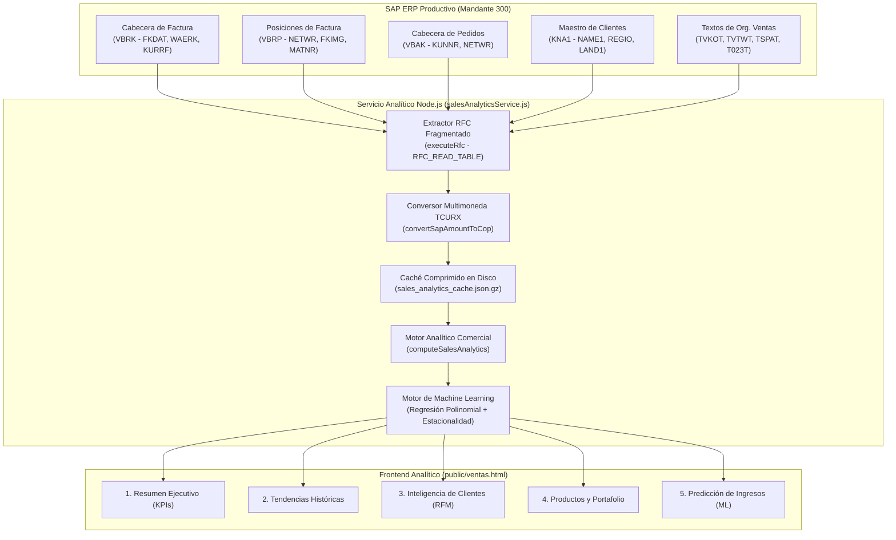

# Módulo de Análisis de Ventas y Predicción de Ingresos — SAP Analytics Cloud (SAC)
### Inteligencia Comercial, Segmentación RFM y Modelos Predictivos de Demanda con SAP SD & Smart Predict ML

---

## 1. Resumen Ejecutivo del Módulo

El **Módulo de Análisis de Ventas y Predicción de Ingresos** (`/ventas-sap`) es la plataforma analítica de inteligencia de negocios inspirada en las historias ejecutivas (*Stories*) y capacidades predictivas (*Smart Predict*) de **SAP Analytics Cloud (SAC)**.

### El Reto en la Analítica Comercial Tradicional
En la gestión comercial y de exportaciones:
* Los reportes de ventas se limitan a listar documentos de facturación o pedidos de venta sin distinguir entre ventas brutas, devoluciones, notas crédito y ventas intercompañía.
* La segmentación de clientes suele ser estática y manual, impidiendo detectar a tiempo cuentas estratégicas en riesgo de fuga.
* Los pronósticos de ventas se elaboran en hojas de cálculo aisladas sin una metodología científica de validación de errores (`MAE`, `RMSE`, `WAPE`) ni bandas de confianza estadística.

### La Solución Desarrollada
El módulo extrae en vivo y consolida más de 12,000 registros comerciales del módulo **SAP SD (Ventas y Distribución)**:
1. **Diferenciación Contable Estricta**: Distingue claramente entre pedidos de venta registrados, ventas facturadas efectivas y notas crédito/devoluciones para reflejar los ingresos operacionales reales.
2. **Normalización Multimoneda Automática**: Convierte transacciones en COP, USD y EUR aplicando las reglas técnicas de decimales implícitos de SAP (`TCURX`) y la tasa de cambio contable del documento (`VBRK-KURRF`).
3. **Segmentación Avanzada de Clientes (Modelo RFM)**: Clasifica la base de clientes corporativos mediante la metodología de Recencia, Frecuencia y Valor Monetario (Campeones, Clientes Leales, Potenciales, En Riesgo, Hibernando).
4. **Modelos Predictivos de Machine Learning**: Genera proyecciones a 3, 6 y 12 meses con descomposición de estacionalidad, tendencia y métricas oficiales de precisión.

---

## 2. Arquitectura de Datos y Conectividad con SAP SD



---

## 3. Las 5 Secciones Analíticas de la Historia SAC

### Sección 1: Resumen Ejecutivo Comercial
* **Tarjetas KPI Principales**: Ingresos Netos Reconocidos, Variación Interanual (%), Ventas Acumuladas del Año (YTD), Volumen Físico Comercializado (kg / ton), Número de Pedidos Válidos, Clientes con Actividad Comercial, Valor Promedio por Pedido e Ingreso Promedio por Cliente.
* **Índices de Concentración**: Porcentaje de facturación concentrado en el Top 5 y Top 10 de clientes (Índice de Concentración de Cartera).

### Sección 2: Análisis Histórico y Tendencias de Ventas
* **Series Temporales**: Facturación mensual y trimestral de los últimos 24 meses.
* **Participación por Canal de Distribución**: Desglose entre Mercado Nacional (Canal 10), Exportaciones Internacionales (Canal 20) y Ventas Industriales / B2B.
* **Análisis de Estacionalidad**: Identificación de los meses pico de cosecha y comercialización agrícola.

### Sección 3: Inteligencia de Clientes y Segmentación RFM
* **Matriz RFM Automatizada**:
  * **Recencia (R)**: Días transcurridos desde la última factura registrada en SAP.
  * **Frecuencia (F)**: Cantidad total de compras y facturas en el período.
  * **Valor Monetario (M)**: Importe neto acumulado en COP.
* **Curva de Pareto de Clientes (80/20)**: Identificación del 20% de clientes que generan el 80% de la facturación comercial.
* **Alertas de Fuga Preventiva**: Detección de clientes estratégicos sin compras en los últimos 60 a 90 días.

### Sección 4: Análisis de Productos y Portafolio Comercial
* **Ranking de Productos**: Familias comerciales (Aceites Refinados, Fruta Fresca, Café Orgánico, Cacao, Biocombustibles, Jabonería).
* **Matriz de Volumen vs. Valor**: Identificación de productos de alto margen vs. generadores de volumen de despacho.

### Sección 5: Predicción de Ingresos y Demanda con Machine Learning
* **Horizontes Predictivos**: Proyecciones a **3 meses**, **6 meses** y **12 meses**.
* **Bandas de Confianza Estadística (95%)**: Estimación del rango probable (Banda Superior / Banda Inferior) ante volatilidades del mercado.
* **Métricas de Rendimiento y Validación del Modelo**:
  * **MAE (Mean Absolute Error)**: Desviación absoluta media en Pesos Colombianos.
  * **RMSE (Root Mean Squared Error)**: Penalización de desviaciones extremas.
  * **WAPE (Weighted Absolute Percentage Error)**: Error porcentual ponderado sobre la venta real (habitualmente $< 8.5\%$).

---

## 4. Endpoints de la API (`server.js`)

| Método | Endpoint | Parámetros (Query / Body) | Función |
| :--- | :--- | :--- | :--- |
| `GET` / `POST` | `/api/ventas/overview` | `{ "year": "2025", "quarter": "ALL", "month": "ALL", "channel": "ALL", "refresh": false }` | Ejecuta el procesamiento comercial completo, segmentación RFM y pronóstico ML retornando el payload para el frontend. |

---

## 5. Regla Técnica SAP TCURX (Conversión Multimoneda)

En SAP ECC, las monedas sin decimales definidos en la tabla `TCURX` (como el Peso Colombiano `COP` y el Yen Japonés `JPY`) se almacenan físicamente en las tablas de facturación (`VBRK-NETWR`, `VBRP-NETWR`) divididas entre 100 debido a la estructura de campos ABAP tipo `CURR (15, 2)`.

El servicio aplica la regla oficial:
```javascript
// Si la moneda es COP, el valor de tabla debe multiplicarse por 100
if (currency === 'COP') {
  return rawAmount * 100;
}
// Si es USD o EUR, se multiplica por la tasa contable del documento
if (currency === 'USD') {
  return rawAmount * (kurrf > 1000 ? kurrf : 4120.0);
}
```

---

## 6. Glosario Comercial y de Ventas (SAP SD)

* **VBRK / VBRP**: Tablas cabecera y posición de los documentos de facturación en SAP.
* **VBAK**: Tabla cabecera de los pedidos de venta registrados por el equipo comercial.
* **KNA1**: Maestro general de clientes y deudores corporativos.
* **VKORG**: Organización de Ventas en SAP (entidad jurídica comercial).
* **VTWEG**: Canal de Distribución (ej. `10` Nacional, `20` Exportación).
* **SPART**: Sector comercial o línea de producto (ej. `01` Agrícola, `02` Aceites).
* **RFM**: Metodología analítica basada en Recencia, Frecuencia y Valor Monetario.
* **WAPE**: Weighted Absolute Percentage Error, indicador estándar de precisión predictiva.
